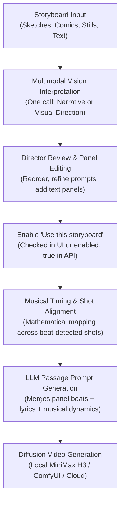
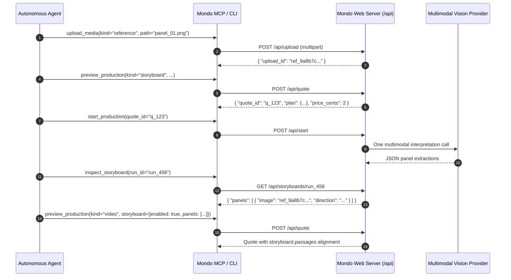

# Storyboard Guide & System Architecture

This document provides a comprehensive operational guide for the **Storyboard** subsystem in Mondo Music Video. It serves two audiences:
1. **Human Directors:** A complete tutorial for storyboarding in the Web UI, from rough sketches to final video assembly.
2. **Autonomous AI Agents & Integrators:** A technical reference covering REST endpoints, CLI commands, MCP tools, and data schemas.

---

## 1. Overview & Core Philosophy

Storyboards bridge the gap between abstract music video planning and concrete visual storytelling. They allow directors to provide sequence sketches, comic book strips, digital paintings, or written panel beats that dictate the visual and narrative progression across a song's musical timeline.



### Core Design Principles

1. **Descriptive Guidance, Not Pixel Cloning:**
   Storyboard images are analyzed by multimodal vision to generate descriptive scene directives for the LLM writer. They are **not** fed into image-to-image diffusion warps or latent blending.
2. **Separation of Storyboard Figures from Actor Identity:**
   People or figures depicted in storyboard sketches are treated strictly as **narrative placeholders**. Facial geometry, wardrobe styling, and actor continuity are controlled exclusively by your assigned Open Actor Protocol (OAP) actor packages and character reference sheets.
3. **Musical Primacy:**
   Storyboards do not stretch or alter the musical timeline. Instead, the storyboard's panels adapt to the song's beat-detected shots, tempos, and passage boundaries.
4. **Zero Automatic Retries:**
   Multimodal vision calls represent paid external or heavy local computation. The storyboard subsystem never retries failed vision requests automatically.

---

## 2. Core Architectural Rules & Invariants

> [!IMPORTANT]
> The engine strictly enforces five architectural invariants across all storyboard operations:

### Rule 1: The Panels-to-Shots Inequality ($\text{panels} \le \text{shots}$)
In a Music Video, **the total number of storyboard panels cannot exceed the total number of planned musical shots**.
- If a song's beat analysis and tempo grid produce 12 shots, you may supply anywhere from 1 to 12 panels.
- Supplying 13 or more panels will cause the production preview to be rejected with:
  `"The storyboard has X panels but the plan has only Y shots; combine panels or use fewer panels"`
- **Remedy:** Consolidate adjacent panels, delete non-essential transitional panels, or adjust the **Bars per phrase** / **Beats per bar** settings in the Musical Rhythm fold to create more musical shots.

### Rule 2: Review-First Invariant (`enabled: false` on load)
When vision interpretation completes and results are loaded into the editor, the **"Use this storyboard"** toggle is **always unchecked by default**.
- This enforces human-in-the-loop review.
- The director must review the generated panel descriptions, adjust text, reorder panels, or prune artifacts before activating the storyboard for production.

### Rule 3: Single Vision Call per Interpretation
Interpreting an uploaded storyboard makes **exactly one** vision request to the configured vision provider (local vision model or cloud API).
- Multi-panel sheets, comic strips, or contact sheets are interpreted within that single pass.
- Adding or reordering images preserves existing panel directions until an explicit re-interpretation is started.

### Rule 4: Replay & Resume Binding
When a production begins, the reviewed storyboard panels and their calculated shot alignments are snapshotted into `prepared.json`.
- If a render is interrupted and resumed, the engine validates that the storyboard alignment has not changed.
- If you reroll an individual passage take in the **Passage Takes** view, the original storyboard panel direction for that specific shot remains locked and authoritative.

### Rule 5: Music Video vs. Ident / Credits Differentiation
- **Music Videos:** Panels are distributed sequentially across discrete, beat-detected camera cuts across the entire song.
- **Idents / Credits:** Because an ident is a single continuous short clip (4–12 seconds), storyboard panels divide its duration into ordered sub-second time slices, allowing multiple micro-beats within a single shot.

---

## 3. Director's Tutorial (Web UI Walkthrough)

### Step 1: Open the Storyboard Editor
1. In the **Music Video** panel (or **Ident / Credits** panel), expand the **Storyboard** fold.
2. Note that storyboards are opt-in and disabled (`Off`) by default.

### Step 2: Upload Storyboard Images or Add Text Panels
* **Uploading Images:** Drag and drop or browse to add up to 24 images (PNG, JPEG, WebP, max 64 MB total).
  - *Single Frames:* Individual concept sketches or digital paintings.
  - *Comic Strips / Contact Sheets:* A single image containing multiple sequential frames. The vision model recognizes multi-panel layouts and extracts distinct directions for each frame while referencing the same source image.
* **Text Panels:** Click **+ Add text panel** to insert narrative beats or visual notes without an underlying image.

### Step 3: Select Interpretation Mode & De-Slop Options
Choose how the vision model should analyze your images:
* **Narrative Mode (Recommended for Storytelling):**
  - Extracts character actions, plot developments, dramatic turns, and emotional tone.
  - *Example output:* `"The figure enters the abandoned records archive and frantically searches through metal filing cabinets."`
* **Visual Direction Mode (Recommended for Cinematography):**
  - Extracts framing, camera angles, perspective, lighting keys, color contrasts, and textures.
  - *Example output:* `"Low-angle Dutch tilt looking up at monolithic brutalist concrete columns, lit by stark amber raking floodlights."`
* **Humanize Directions Checkbox (Opt-in):**
  - Check **☑ Humanize directions (strip AI clichés)** to automatically purge synthetic LLM tropes (*"testament to"*, *"delve into"*, *"rich tapestry of"*, *"dance of light and shadow"*, *"palpable tension"*), frame throat-clearing (*"in this shot we see"*), and trailing purple explanations from the vision output before populating panels.

### Step 4: Preview Quote & Execute Interpretation
1. Click **Preview Interpretation** (or **Interpret Storyboard**).
2. The system checks the configured vision provider (Settings panel) and displays an estimated cost quote.
3. Confirm and start the interpretation. The progress bar will indicate vision analysis.
4. If an interpretation fails, click **Inspect saved response** to view the raw output without incurring another API charge.

### Step 5: Review, Edit, and Curate Panels
Once finished, refresh **Saved interpretations** and load your run:
* **Edit Direction:** Click into any panel's text area to refine, correct, or expand the prompt direction.
* **✨ Humanize Directions Button:** Click **Humanize directions** at any time to run the de-slopping pass across all currently loaded panels in the editor, instantly stripping clichés and throat-clearing from hand-entered or previously imported text.
* **Reorder Panels:** Use the **▲ Move up** and **▼ Move down** buttons to ensure panels match the song's narrative progression.
* **Remove / Add:** Delete weak panels or add clarifying text panels.

### Step 6: Enable Storyboard & Preview Musical Alignment
1. Check the box: **☑ Use this storyboard**.
2. Click **Preview Production** at the top of the Music Video panel.
3. In the preview breakdown modal, inspect the **Passages & Shots** table:
   - Each shot displays its assigned storyboard panel number, thumbnail, and start timestamp (e.g. `Shot 3: Panel 2 @ 0:14.2s`).
   - Verify that the narrative beats synchronize naturally with your verse, chorus, and bridge transitions.

---

## 4. Pipeline Integration & Mathematical Alignment

When the production planner prepares a video, it maps $N_{\text{panels}}$ across $N_{\text{shots}}$ using the proportional indexing formula in [`mmv/storyboard.py`](file:///c:/Users/Desktop-Dev/Desktop/hodge/mmv/storyboard.py#L86-L91):

$$\text{panel\_index} = \min\left(N_{\text{panels}} - 1,\, \left\lfloor \frac{i \times N_{\text{panels}}}{N_{\text{shots}}} \right\rfloor \right)$$

where $i$ is the zero-based index of the current shot across all passages.

```
Total Shots: 12  [ Shot 0 | Shot 1 | Shot 2 | Shot 3 | Shot 4 | Shot 5 | Shot 6 | Shot 7 | Shot 8 | Shot 9 | Shot 10 | Shot 11 ]
Panels: 4       [ ------- Panel 1 ------- ] [ ------- Panel 2 ------- ] [ ------- Panel 3 ------- ] [ -------- Panel 4 -------- ]
```

### LLM Writer Context Injection

During prompt writing in [`mmv/worker.py`](file:///c:/Users/Desktop-Dev/Desktop/hodge/mmv/worker.py#L433-L435), the engine packages the aligned panels into a structured writer payload:

```json
{
  "mode": "narrative",
  "shots": [
    {
      "shot": 1,
      "panel": 2,
      "start_seconds": 12.45,
      "direction": "The detective steps into the sodium-lit stairwell, unholstering a flashlight."
    }
  ],
  "guidance": "Follow these ordered storyboard directions within the supplied shot timing. Keep the assigned cast identities, reference bindings, mouth rules and motion requirements. Storyboard people are placeholders for the assigned cast. Prioritize story, action and mood."
}
```

The writer LLM incorporates these beats while preserving:
- **Actor Casting:** Replacing storyboard figures with your assigned OAP actors.
- **Sealed Lips:** Enforcing closed mouths unless lyrics and vocalist coaching authorize singing.
- **Visual Vocabulary:** Injecting chosen setting, lighting, and mechanism keywords.

---

## 5. Autonomous Agent & API Integration Reference

Autonomous agents can fully operate the storyboard subsystem via the MCP server, CLI client, or REST API.

### 5.1 Step-by-Step Agent Workflow



### 5.2 API Request Payloads

#### 1. Requesting Storyboard Interpretation
```http
POST /api/quote
Content-Type: application/json

{
  "kind": "storyboard",
  "direction": "A sci-fi escape from a subterranean facility to the surface at dawn",
  "storyboard": {
    "mode": "narrative",
    "humanize": true,
    "images": ["ref_ab12cd34.png", "ref_ef56gh78.png"]
  }
}
```

#### 2. Starting Interpretation
```http
POST /api/start
Content-Type: application/json

{
  "quote_id": "q_storyboard_8831b"
}
```

#### 3. Applying Reviewed Panels to a Music Video Request
```http
POST /api/quote
Content-Type: application/json

{
  "kind": "video",
  "song": "song_upload_id.mp3",
  "direction": "Moody industrial escape",
  "storyboard": {
    "enabled": true,
    "mode": "narrative",
    "images": ["ref_ab12cd34.png", "ref_ef56gh78.png"],
    "panels": [
      {
        "image": "ref_ab12cd34.png",
        "direction": "Subject races down a narrow carbide-lit drift, pursued by shadows."
      },
      {
        "image": "ref_ef56gh78.png",
        "direction": "Subject reaches the elevator cage and trips the emergency ascent lever."
      },
      {
        "image": "",
        "direction": "The cage breaks through the surface into blinding dawn sunlight."
      }
    ]
  }
}
```

### 5.3 CLI Commands

```powershell
# 1. Upload images in reading order
mondo-music-video-agent upload reference "C:\stills\panel_01.png"
mondo-music-video-agent upload reference "C:\stills\panel_02.png"

# 2. Preview and start storyboard interpretation
mondo-music-video-agent preview '{"kind":"storyboard","storyboard":{"mode":"narrative","images":["panel_01.png","panel_02.png"]}}'
mondo-music-video-agent start QUOTE_ID

# 3. List completed interpretations and inspect panel results
mondo-music-video-agent storyboards
mondo-music-video-agent storyboard-result RUN_ID

# 4. In case of vision model parse failure, retrieve raw response
mondo-music-video-agent storyboard-result RUN_ID --raw-response
```

### 5.4 MCP Tools

* **`inspect_studio(kind="storyboards")`**: Lists all saved storyboard interpretation runs.
* **`inspect_storyboard(run_id, raw_response=false)`**: Retrieves parsed panels for a run, or the raw text response for diagnosing errors.
* **`preview_production(request)`**: Accepts `kind: "storyboard"` for interpretation quotes, or `kind: "video"` with `storyboard: { enabled: true, ... }` to calculate shot alignment.
* **`start_production(quote_id)`**: Executes an approved storyboard quote or video production.

---

## 6. Diagnostics, Failure Recovery & Privacy

### Diagnosing Failed Interpretations
If the vision model returns an unparseable response or encounters an API error:
1. The raw text response is saved immediately to `storyboard-response.txt` inside the operation's run directory.
2. Call `inspect_storyboard(run_id, raw_response=true)` or click **Inspect saved response** in the UI.
3. This allows you to inspect model output or copy extracted text panels manually without making another paid call.

### Resuming Interrupted Renders
If a rendering job fails or is interrupted:
- The alignment mapping between storyboard panels and shot IDs is frozen in `prepared.json`.
- When resuming via `preview_resume` / `start_production`, the engine verifies that the storyboard binding matches the original run.
- Attempting to resume with an altered storyboard configuration is rejected to prevent mismatched prompt takes.

### Privacy & Data Boundaries
- **Local Isolation:** Uploaded storyboard images remain in the user's private data directory (`uploads/`).
- **No Artifact Leakage:** Production packages, OAP audition exports, and demo receipts explicitly strip storyboard source images and raw storyboard metadata (`package_export.py` removes the `storyboard` key).
- **Public Roster Integrity:** Storyboard images are never converted into public actors or added to public style presets.

---

## 7. Troubleshooting & FAQ

| Problem | Root Cause | Solution |
| :--- | :--- | :--- |
| **"The storyboard has X panels but the plan has only Y shots"** | The song generates fewer camera cuts than the number of storyboard panels provided. | Combine adjacent panels, delete transitional panels, or decrease **Bars per phrase** (e.g. from 4 to 2) to generate more musical shots. |
| **Character in video doesn't look like the storyboard sketch** | Storyboards provide narrative direction, not actor identity. | Assign an Open Actor Protocol (OAP) actor reference sheet. Storyboard figures are treated as anonymous visual placeholders. |
| **Interpretation button is disabled or reports missing vision provider** | No vision provider is active. | Open the **Settings** panel and configure an API key (OpenAI, Anthropic, Gemini, OpenRouter) or start the local vision server (`mmv.vision_service`). |
| **Panels appear in the wrong chronological order** | Images were uploaded or sorted out of narrative sequence. | Use the **▲ Move up** and **▼ Move down** buttons on each panel card to restore correct chronological order before enabling. |
| **Text-only panel needs to be added without an image** | A specific narrative beat is needed that has no drawing. | Click **+ Add text panel**. Leave the image reference blank (`image: ""`) and enter the direction text directly. |
