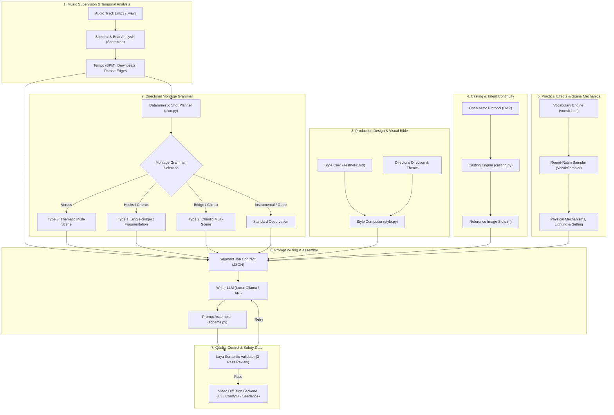

# Studio Direction & Video Prompting Architecture

This guide details the prompt construction architecture of Mondo Music Video, translating the generative pipeline's internal mechanisms and "skills" into the established language of a professional film and music video production studio. It also provides the technical post-mortem on the "floating paper" phenomenon and explains how directors can steer scene elements through the user interface.

---

## 1. Studio Hierarchy & Departmental Architecture

Rather than prompting video generation models with monolithic text paragraphs, Mondo operates like a film studio where specialized departments handle distinct creative disciplines. Each department contributes deterministic constraints, musical math, or artistic bibles before the prompt writer ever drafts a single scene.



### 1.1 Music Supervision & Editorial Rhythm (The Audio Department)
- **Engine Module**: `mmv/engine/analyze.py` (`ScoreMap`)
- **Studio Analogy**: Music Editor & Choreographer
- **Function**:
  Music videos are cut to rhythm, not clock time. The audio engine analyzes the track using spectral flux, onset detection, and beat tracking (`aubio` or `librosa` with robust fallback heuristics).
  - Identifies overall tempo (BPM) and maps every beat frame and downbeat frame.
  - Groups musical bars into coherent musical phrases (e.g., 2 or 4 bars per phrase).
  - Ensures every planned cut lands precisely on an editorial downbeat.

### 1.2 Directorial Montage & Camera Grammar (The Director's Chair)
- **Engine Module**: `mmv/engine/plan.py`
- **Studio Analogy**: Lead Director & Senior Editor
- **Function**:
  Maps the song's energetic contours to one of four directorial montage structures:
  1. **Standard Observation**: Sustained takes, single dominant subject, steady lighting and environment. Best suited for contemplative interludes or slow instrumental builds.
  2. **Type 1: Single-Subject Fragmentation**: Rapid, rhythmic cutting centered on a single recurring lead character. Used on song hooks and choruses to anchor star presence while varying camera angles, scales, and focal lengths.
  3. **Type 2: Chaotic Multi-Scene**: Rapid, discontinuous, collision montage. Every cut introduces a new subject, setting, and act. Designed for build-ups, breakdowns, or climactic sonic overload.
  4. **Type 3: Thematic Multi-Scene**: Conceptual montage where disparate subjects and settings are linked by a single recurring physical or poetic anchor (the `thematic_anchor`).

### 1.3 Production Design & Cinematography Bible (Art Department & DP)
- **Engine Module**: `mmv/engine/style.py` & `mmv/engine/styles/`
- **Studio Analogy**: Production Designer & Director of Photography
- **Function**:
  Establishes the visual world before a scene is described:
  - **Aesthetic Cards (`aesthetic.md`)**: Specifies film stock, grain texture, color timing/grading, lens distortion, depth of field, and lighting logic.
  - **Refusal Rules**: Explicitly lists what the camera refuses to depict (e.g., clean digital smoothing, artificial lens flares, specific color shifts).
  - **Style Harvesting**: Can ingest user-supplied still images and deconstruct them through computer vision into craft rules, color gamuts, and composition grammars.

### 1.4 Talent & Casting Continuity (Casting Department)
- **Engine Module**: `mmv/engine/actor.py` & `mmv/engine/casting.py`
- **Studio Analogy**: Casting Director & Wardrobe Stylist
- **Function**:
  Maintains character identity and wardrobe across generative diffusion models:
  - Leverages the **Open Actor Protocol (OAP)** to bind facial reference sheets and identity manifests to reference image tags (`<Picture 1>`, `<Picture 2>`).
  - Enforces the hard rule: **"One dominant subject per shot"** to prevent cross-character identity bleed in diffusion models.
  - Locks costume design so character clothing remains consistent across separate render cuts.

### 1.5 Practical Effects & Physical Dynamics (SFX Department)
- **Engine Module**: `mmv/engine/config/vocab.json` & `VocabSampler`
- **Studio Analogy**: Practical Effects (SFX) Supervisor & Stunt Coordinator
- **Function**:
  Provides tactile, physical motion inside the frame to prevent "static waxwork" diffusion outputs. Injects practical camera dynamics, lighting states, and environmental mechanisms (wind, light pulses, reflections, water ripples, moving shadows).

### 1.6 Performance Rigging & Lip-Sync Suppression (Actor Coaching)
- **Engine Module**: `mmv/engine/schema.py`
- **Studio Analogy**: Dialogue Coach & Choreographer
- **Function**:
  AI video models tend to hallucinate rubbery, unnatural lip-sync or rubber-mouthed mumbling when music plays.
  - When **Silent Mouths** is active (default for instrumental or background sections), prompts strictly mandate: `"lips firmly sealed shut, jaw completely relaxed, natural breathing"`.
  - When natural mouths or performance shots are enabled, facial movement is relaxed and articulated for singing or expression.

### 1.7 Diegetic Sound Design (Sound Design & Foley)
- **Engine Module**: `mmv/engine/prompts/writer_base.md` (`overall_soundscape`)
- **Studio Analogy**: Foley Artist & Sound Designer
- **Function**:
  While the song's master music track is placed in post-production (`non_diegetic_music: N/A`), video diffusion engines (such as Hailuo / MiniMax H3) model picture and sound jointly. Writing rich diegetic foley descriptions (e.g. wet asphalt, rustling coats, distant sirens, wind through grates) significantly improves the physical realism and weight of on-screen motion.

### 1.8 Quality Assurance & Studio Continuity Gate (Studio Executive)
- **Engine Module**: `mmv/engine/validators/laya_semantic.py`
- **Studio Analogy**: Studio Continuity Supervisor & Broadcast Standards
- **Function**:
  Before any prompt is dispatched to a GPU or API provider, Laya runs a 3-pass semantic and structural audit:
  - Validates that every planned shot has an explicit, concrete action.
  - Checks visual density and word budgets.
  - Enforces restriction compliance (prohibiting nudity, blood, violence, or sexual content).
  - If a prompt fails, generates corrective notes and forces the writer to retry.

---

## 2. Anatomy of a Segment Job Contract & Assembled Prompt

When a music video segment is generated, the pipeline compiles a strict JSON job contract for the writer:

```json
{
  "segment_id": "seg002",
  "montage_type": "type3_thematic_multi_scene",
  "thematic_anchor": "reflections rippling across glass",
  "duration_seconds": 6.8,
  "shot_count": 3,
  "footage_anchor": "Cinematic music-video photography",
  "practical_effects": "Wind, moving fabric, and shifting light",
  "rigging": "lips firmly sealed shut, jaw completely relaxed",
  "audio_tag": "<Audio 1>",
  "picture_tags": ["<Picture 1>"],
  "theme": {
    "conceptual_theme": "solitude"
  },
  "shots": [
    {
      "n": 1,
      "duration_seconds": 2.2,
      "shot_scale": "medium shot",
      "camera": "The camera pushes in with small amplitude at slow speed",
      "energy_0_to_1": 0.35,
      "vocabulary": {
        "setting": "rain-washed city street",
        "subject_type": "musician in a tailored jacket",
        "mechanism": "reflections rippling across glass",
        "lighting": "warm side light",
        "tonal_register": "quiet reflection",
        "costume": "tailored streetwear"
      }
    }
  ]
}
```

The writer responds with structured prose, which `schema.py` compiles into the final multi-field production prompt:
1. `subject_definitions:` Formal binding of characters and references.
2. `summary:` Editorial overview and reference tracking.
3. `retention_analysis:` Verification of character traits across shots.
4. `detailed_description:` Timecoded cut sequence (`[Shot 1] At 00:02.200, cuts to...`) embedding camera moves, character actions, and environmental dynamics.
5. `overall_soundscape:` Rich diegetic room tone and physical sound.
6. `non_diegetic_music:` Always locked to `N/A`.

---

## 3. Investigation: The "Floating Paper" Phenomenon

### 3.1 The Observation
In generated videos, directors frequently notice unexpected sheets of paper, fluttering flyers, drifting newspapers, or swirling documents appearing across scenes, even in settings where paper makes no narrative sense (e.g., desert roads, shorelines, or moody interiors).

### 3.2 Root Cause Analysis

The occurrence is caused by the interaction of three architectural elements in the engine:

#### 1. The Original 5-Item Mechanism Bottleneck (Resolved in 1.0.15)
Originally, `mmv/engine/config/vocab.json` contained only five entries in the practical mechanisms table:
```json
"mechanisms": [
  "wind moving fabric",
  "reflections rippling across glass",
  "moving shadows",
  "paper turning in the breeze",
  "lights pulsing across surfaces"
]
```

#### 2. Deterministic Sampling Without Replacement
In `mmv/engine/plan.py`, the `VocabSampler.pick()` algorithm pulls from this table using a cycle without replacement:
```python
def pick(self, table: str) -> str:
    pool = list(self.vocab[table])
    seen = self.used.setdefault(table, [])
    remaining = [x for x in pool if x not in seen]
    if not remaining:
        seen.clear()
        remaining = pool
    choice = self.rng.choice(remaining)
    seen.append(choice)
    return choice
```
When the list contained only 5 items, `"paper turning in the breeze"` had a **20% chance per pick** and was **mathematically guaranteed to be drawn once every 5 mechanism picks**.

In **1.0.15**, `vocab.json` expands `"mechanisms"` to **32 practical cinematic and micro-performance dynamics**, reducing the selection frequency of `"paper turning in the breeze"` from **20% down to ~3%**.

#### 3. Section Anchor Inheritance
When a section is assigned `type3_thematic_multi_scene`:
```python
anchor = sampler.pick("mechanisms") if montage_type == THEMATIC else None
# ...
sh.vocab["mechanism"] = anchor or sampler.pick("mechanisms")
```
Whatever mechanism is drawn as the `thematic_anchor` is inherited across **every single shot in that segment** as its binding physical anchor.

#### 4. The Writer Contract Hard Rule
In `writer_base.md`, the writer LLM is strictly instructed:
> *"The planner has already computed, and you must not attempt to influence... which vocabulary each shot draws on."*
> *"type3_thematic_multi_scene — every shot a new subject and setting, all obeying the thematic_anchor. Name the anchor explicitly in summary."*

When `"paper turning in the breeze"` is selected, the writer LLM dutifully complies by inventing reasons for paper to appear in every shot (e.g., *"a discarded newspaper drifts across the asphalt"*, *"sheets flutter from an open briefcase"*, *"paper pages turn softly on the table"*).

#### 5. Latent Space Diffusion Bias
Diffusion video models (such as MiniMax / Hailuo H3) have high latent sensitivity to the words *"paper"* and *"breeze"*. When instructed that paper is turning in the breeze, the model frequently generates surreal, gravity-defying floating sheets of paper drifting through the frame.

---

## 4. How Directors Can Steer & Override Scene Mechanics

### 4.1 The Expanded 32-Mechanism Studio Pool

`mmv/engine/config/vocab.json` provides 32 ambient, physical, and micro-performance mechanisms:
1. `"wind moving fabric"`
2. `"curtains billowing in a gentle draft"`
3. `"overhead hanging wires or pendant lamps gently swaying"`
4. `"paper turning in the breeze"`
5. `"loose hair tendril shifting across the cheek on exhalation"`
6. `"pre-speech breath intake lifting the chest and parting lips"`
7. `"moving shadows"`
8. `"long shadows stretching across the floor"`
9. `"venetian blind shadow slats raking across surfaces and skin"`
10. `"dappled sunlight shifting through tree foliage"`
11. `"reflections rippling across glass"`
12. `"rain rivulets shearing diagonally down glass"`
13. `"condensation beads slowly trickling down cold surfaces"`
14. `"melting ice cubes settling and shifting in a glass"`
15. `"water caustics rippling across interior walls and ceilings"`
16. `"liquid meniscus trembling in a glass from ground vibration"`
17. `"concentric ripples expanding across a puddle from an off-screen drip"`
18. `"heat shimmer warping the distant horizon"`
19. `"airborne dust motes drifting through raking natural light"`
20. `"low-lying fog or mist creeping across the ground plane"`
21. `"steam rising and curling into cool air"`
22. `"ash tip lengthening and crumbling from a burning cigarette"`
23. `"passing car headlights sweeping sharp beams across interior walls"`
24. `"fluorescent ballast micro-flicker"`
25. `"television flicker projecting fluctuating bounce light"`
26. `"masseter jaw muscle knotting and releasing along the jawline"`
27. `"rapid ocular saccades scanning between focal points"`
28. `"waterline sheen accumulating along the lower eyelid margin"`
29. `"visible glottal swallow shifting the larynx during silence"`
30. `"subtle lens breathing during shallow rack focus"`
31. `"foreground silhouette wiping across the lens during lateral track"`

### 4.2 Using the Web UI Controls

The Mondo web interface provides two direct channels into the prompt writing engine:

#### 1. Visual Direction (`direction`)
In the web interface under **Visual direction**, any text entered is appended directly to the LLM system prompt under:
```text
DIRECTOR'S DIRECTION:
{user_direction}
```
Because this block sits after the base rules, strong writer models treat it as active director notes.

**To completely prohibit paper and floating debris:**
Enter explicit practical directives in your Visual Direction, for example:
> *"Ground all environmental physics in wet reflections, heavy rain, and atmospheric mist. Do not include loose papers, documents, flyers, or litter. Keep all surfaces industrial and solid."*

**To lock a specific environmental element:**
> *"The recurring visual mechanism across all scenes must be swirling embers, drifting dust motes, and neon light pulses on wet metal."*

#### 2. Conceptual Theme (`conceptual_theme`)
The **Conceptual theme** input (e.g. *"nostalgia"*, *"cybernetic isolation"*, *"grief"*, *"kinetic velocity"*) provides the emotional and metaphorical thread. While it does not directly replace vocabulary keywords, it gives the writer LLM the *purpose* behind the physical movement, discouraging generic interpretations of prompt mechanisms.

---

## 5. Director's Quick Reference & Troubleshooting

| Observation | Studio Department | Underlying Cause | Director's Remedy |
| :--- | :--- | :--- | :--- |
| **Floating paper or flyers in a shot** | SFX / Vocab | Draw of `"paper turning in the breeze"` (4% pool weight in `vocab.json`). | Reroll the variation seed, or add *"Do not depict loose paper, documents, or flyers"* in **Visual direction**. |
| **Unnatural mouth twitching or phantom singing** | Actor Coaching | Lip-sync suppression was inactive during an instrumental or dialogue-free beat. | Check that **Silent Mouths** is checked in settings for instrumental tracks. |
| **Characters morphing or changing clothing** | Casting | Identity bleed across parallel subjects or missing OAP actor assignment. | Assign an OAP actor reference sheet; ensure **"One dominant subject per shot"** rule is observed. |
| **Cuts feel off-beat or disconnected from song** | Editorial | Incorrect bars-per-phrase grid or non-standard time signature. | Adjust **Bars per phrase** (try 2 or 4 bars) or re-run beat detection with adjusted sensitivity. |
| **Scenes look too clean, sterile, or CGI** | Production Design | Default clean grading without film stock or grain directives. | Harvest a style from moody cinematic reference stills or specify 35mm grain, lens distortion, and bloom in Visual Direction. |

