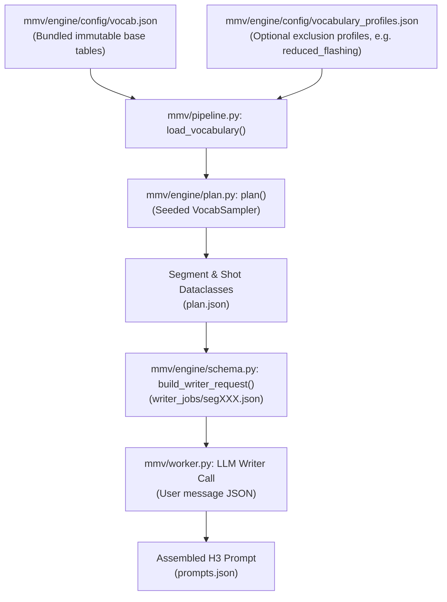

# Visual Vocabulary (`vocab.json`) Architecture & User Customization Guide

This document explains how [`mmv/engine/config/vocab.json`](../mmv/engine/config/vocab.json) works inside the Mondo Music Video pipeline, how each table is sampled and handed to the LLM writer, what constraints protect the original engine, and how we can give users fine-grained control over selecting, filtering, or adding their own vocabulary entries.

---

## 1. Purpose of `vocab.json`

Language models are notoriously bad at maintaining variety across many sequential calls: left to themselves, they repeat the same settings (*"neon-lit alley"*, *"rain-soaked street"*), the same camera moves, and the same actions across every passage of a song.

Instead of asking the LLM to "be creative and avoid repetition," Mondo's deterministic planner ([`mmv/engine/plan.py`](../mmv/engine/plan.py)) uses [`vocab.json`](../mmv/engine/config/vocab.json) and a seeded [`VocabSampler`](../mmv/engine/plan.py#L282-L319) to **pre-select concrete visual ingredients for every segment and every shot** before the LLM writer is ever called.

---

## 2. Structure of `vocab.json` (The 11 Tables)

[`mmv/engine/config/vocab.json`](../mmv/engine/config/vocab.json) contains **11 keys** divided into two categories: **Energy-Mapped Camera/Framing Pools** (2 keys) and **Seeded Rotation Pools** (9 keys).

### A. Energy-Mapped Camera & Framing Pools

These two tables are sampled based on the **musical energy (`0.0` to `1.0`)** of each individual shot at its beat timestamp:

| Key | Count | Type | How `VocabSampler` Uses It |
| :--- | :---: | :--- | :--- |
| `camera_by_energy` | 22 moves across 5 bands (`"0.00"`, `"0.25"`, `"0.50"`, `"0.75"`, `"0.90"`) | `dict[str, list[str]]` | `sampler.camera_for(energy)` selects the highest threshold band `<= shot.energy` and picks a camera move from that band with `rng.choice()`. Note: H3's motion vocabulary is a closed set of camera verbs (`holds a static shot`, `pushes in`, `tracks`, `arcs`, `pans`, `pedestals`, `pulls out`, `shakes`, `rolls`, `whips`). |
| `shot_scales` | 20 scales | `list[str]` | `sampler.scale_for(energy)` picks from all 20 shot scales (`extreme wide shot`, `medium shot`, `two shot`, `worms-eye`, etc.) when `energy <= 0.75`, or filters to `"close"` / `"macro"` scales (`medium close-up`, `close-up`, `extreme close-up`, `macro shot`) when `energy > 0.75`. |

### B. Seeded Rotation Pools (`sampler.pick(table)`)

These nine tables are sampled **without replacement** by `VocabSampler.pick(table)` using the production `seed`. Once a table is completely exhausted, its `seen` list resets and rotation begins again. This guarantees zero repetition within a song.

#### Segment-Level Rotation Pools (Picked once per musical passage / segment)

| Key | Count | Examples | Role in the Pipeline |
| :--- | :---: | :--- | :--- |
| `footage_anchors` | 70 | `"35mm anamorphic cinema footage"`, `"16mm Ektachrome reversal film"`, `"VHS tape transfer"` | Sets the physical film/video texture for the entire segment (`segment.footage_anchor`). |
| `practical_effects` | 111 | `"Practical haze effects"`, `"Practical prism effects"`, `"Practical liquid-light effects"` | Assigns an in-camera physical effect for the segment (`segment.practical_effects`). |
| `rigging` | 1 | `"lips firmly sealed shut, jaw completely relaxed"` | Supplies the lip-sync suppression phrase (`segment.rigging`) when `silent_mouths` is active. |

#### Shot-Level & Montage-Level Rotation Pools

| Key | Count | Examples | Role in the Pipeline |
| :--- | :---: | :--- | :--- |
| `settings` | 269 | `"concert hall"`, `"salt flat"`, `"watchmaker's bench"`, `"locomotive roundhouse"` | Physical location (`shot.vocab["setting"]`). |
| `subject_types` | 233 | `"solo performer"`, `"watchmaker"`, `"archivist"`, `"dancer"` | Archetype/role when no actor reference overrides it, or contextual role (`shot.vocab["subject_type"]`). |
| `mechanisms` | 256 | `"extraction"`, `"suspension"`, `"refraction"`, `"unspooling"`, `"pendulum swing"` | Physical action/process driving motion in the shot (`shot.vocab["mechanism"]`). Also used as `segment.thematic_anchor` in `type3_thematic_multi_scene`. |
| `lighting` | 227 | `"overcast daylight"`, `"sodium vapor streetlamp"`, `" dappled canopy light"` | Lighting setup for the shot (`shot.vocab["lighting"]`). |
| `tonal_registers` | 185 | `"ceremonial"`, `"clinical"`, `"elegiac"`, `"feverish"`, `"deadpan"` | Emotional/cinematic mood (`shot.vocab["tonal_register"]`). |
| `costume` | 31 | `"heavy wool coat"`, `"structured workwear"`, `"oilskin coat"`, `"layered linen"` | Wardrobe texture/silhouette when not locked by an OAP actor sheet (`shot.vocab["costume"]`). |

---

## 3. End-to-End Data Flow

### How Montage Type Affects Shot Vocabulary Sampling ([`mmv/engine/plan.py:536-560`](../mmv/engine/plan.py#L536-L560))

When `plan()` builds shots for a segment, the section's energy label determines its `montage_type`, which controls whether vocabulary rotates **every shot** or stays **unified across the segment**:

1. **`standard`** (Low energy) & **`type1_single_subject_fragmentation`** (Peak energy):
   - **Varies per shot**: `lighting`, `camera`, `shot_scale`
   - **Shared across all shots in the segment**: `setting`, `subject_type`, `mechanism`, `tonal_register`, `costume`
   - *Why*: Keeps the performer in one coherent location and wardrobe while cuts and lighting shift with the beat.
2. **`type3_thematic_multi_scene`** (Mid energy):
   - **Locked for the whole segment**: `thematic_anchor` (drawn once from `mechanisms` for the entire musical section, and forced into every shot's `mechanism`).
   - **Rotates on every shot**: `setting`, `subject_type`, `lighting`, `tonal_register`, `costume`.
   - *Why*: Collides different worlds and subjects around one shared physical action/theme.
3. **`type2_chaotic_multi_scene`** (High energy):
   - **Rotates on every shot**: `setting`, `subject_type`, `mechanism`, `lighting`, `tonal_register`, `costume`.
   - *Why*: Rapid, discontinuous montage where every cut lands in a new place with a new action.

---

## 4. What Is Locked vs. What Can Be Customized

### Locked File Integrity
- [`mmv/engine/config/vocab.json`](../mmv/engine/config/vocab.json) has its SHA-256 checksum (`123bc604...`) verified by `test_expanded_rotation_pools_are_sfw_unique_and_traceable` in [`tests/test_original_engine.py`](../tests/test_original_engine.py#L59-L87) and recorded in [`docs/SOURCE_EXTRACTION.json`](../docs/SOURCE_EXTRACTION.json#L208-L279).
- [`mmv/engine/schema.py`](../mmv/engine/schema.py) and [`mmv/engine/prompts/writer_base.md`](../mmv/engine/prompts/writer_base.md) are also hash-locked (`adaptation: "none"`).
- **Rule**: Never edit `mmv/engine/config/vocab.json` in place for user preferences. Instead, apply all user filtering, selection, and custom entries in [`mmv/pipeline.py:load_vocabulary()`](../mmv/pipeline.py#L21-L30) (which is Mondo Music Video's portable orchestration layer) before passing the `vocab` dictionary into `plan(..., vocab=vocab)`.

### Existing Customization Hook (`vocabulary_profile`)
Currently, [`mmv/pipeline.py`](../mmv/pipeline.py#L21-L30) supports a single dropdown field `vocabulary_profile` (`"full"` or `"reduced_flashing"`), which reads [`mmv/engine/config/vocabulary_profiles.json`](../mmv/engine/config/vocabulary_profiles.json) and removes flash/strobe items from `lighting` and `practical_effects`.

---

## 5. How to Add User Control & Custom Vocabulary Entries

Because `plan()` accepts any Python `dict` as its `vocab` argument (as long as each required table has at least 1 item), we can give users rich control in `mmv/pipeline.py`, `mmv/storage.py`, and the Web UI without touching the locked engine files.

Here are the three levels of control we can add (individually or together):

### Option A: Per-Run / Per-Project Custom Overrides in the Production Form
Allow the user to constrain or override specific tables for a single video right in the **Music Video** form (under an expandable **Visual Vocabulary & World Pools** drawer):
- **Mode per category (`settings`, `lighting`, `mechanisms`, `costume`, `tonal_registers`, `footage_anchors`, `practical_effects`)**:
  1. **Use Default Pool (with optional exclusions)**: Use the 269 built-in settings, optionally unchecking items or tags.
  2. **Add to Default Pool (`append`)**: Mix user-supplied entries into the built-in pool.
  3. **Use Only My Entries (`replace` / `lock`)**: Replace a pool with 1 or more user-specified items!
     - *Example*: If a user wants the entire video set only in `"abandoned brutalist concrete cathedral"` and `"submerged server room"`, they type those two lines under **Custom Settings (Only Use These)**, and `VocabSampler` will strictly alternate between only those two locations across the entire video.
     - *Example*: Locking `footage_anchors` to `"16mm Kodak Vision3 500T film"` so the planner never randomly hands the writer `"VHS tape transfer"` or `"security camera footage"` on segment 3.

### Option B: Saved Reusable "Vocabulary Packs / World Palettes" (`data/vocabularies/*.json`)
Just like **Styles** (`data/styles/*.json`) and **Actors** (`data/actors/`), users can save named **Vocabulary Presets** in their private `MMV_HOME/vocabularies/` folder:
- A preset can define custom lists (either `"mode": "replace"` or `"mode": "append"`, plus `"exclude": [...]`) for any of the rotation tables (`settings`, `subject_types`, `mechanisms`, `costume`, `tonal_registers`, `lighting`, `footage_anchors`, `practical_effects`, `shot_scales`).
- Users can create themed packs—e.g. **Cyberpunk Noir**, **Pastoral Folk**, **1970s Grindhouse**, **Minimalist Studio Performance**—and select them from the **Visual vocabulary** dropdown alongside `Full expanded pool` and `Reduced flash/strobe`.

### Option C: Interactive Vocabulary Browser & Editor Modal in the UI
Add a **Customize Vocabulary** button next to the **Visual vocabulary** select box in the UI that opens a modal where the user can:
1. **Browse & Search** all 9 rotation tables (`settings`, `lighting`, `mechanisms`, `costume`, `tonal_registers`, `subject_types`, `footage_anchors`, `practical_effects`, `shot_scales`).
2. **Toggle / Pin / Exclude** individual entries with checkboxes (or click **"Clear All"** on a category to pick only 3–5 favorite settings/lighting styles/film stocks).
3. **Add Custom Entries** (text input / multi-line paste) to any category.
4. **Save as Preset** (stored in `MMV_HOME/vocabularies/<id>.json`) or apply directly to the current production request.

---

## 6. Guardrails When Accepting User Vocabulary

If we implement user-customizable vocabulary, `mmv/pipeline.py` should enforce four simple safety checks when merging user overrides into `vocab`:
1. **Non-Empty Table Fallback**: `VocabSampler.pick(table)` calls `random.choice(remaining)`. If a user excludes every item in a table and provides no replacements, either fall back to the default table or raise a clear `ValueError("Vocabulary table 'settings' cannot be empty")`.
2. **Closed Camera Vocabulary**: Keep `camera_by_energy` restricted to valid H3 camera motion strings (or allow selecting a subset of the 22 existing moves, e.g., disabling `"The camera shakes strongly"` or `"The camera rolls..."`), because `writer_base.md` states: *"Do not invent camera moves — H3's motion vocabulary is a closed set and anything outside it degrades the result."*
3. **Preserve `rigging`**: Keep `rigging` locked to `["lips firmly sealed shut, jaw completely relaxed"]` so [`mmv/engine/schema.py:validate_prompt()`](../mmv/engine/schema.py#L272-L273) (`RIGGING_TAIL`) never fails lip-sync validation.
4. **Quote Fingerprinting**: Because `prepare()` already stores the resulting `plan` inside `prepared['plan']`, and `fingerprint()` hashes `prepared` + `request`, any custom vocabulary selections or entries included in `request` will automatically invalidate stale preview quotes if changed.

---

## 7. Thematic Worlds & Classification Engine

The **Thematic Worlds & Classification** workspace inside **02 / Visual Vocabulary** provides an intelligent semantic layer above the raw 12 keyword tables. It aligns the music video planner to coherent visual themes, controls the juxtaposition tension arc (&kappa;) across song sections, and lets directors curate rotation pools before rendering.

### A. How Thematic Worlds Works (Step 1: Matched Worlds)

1. **Semantic Premise Embedding**: The director inputs a song premise or thematic visual direction (e.g., *"A night-shift clerk drifts through an endless government archive"*).
2. **Anchor World Scoring**: The system computes semantic similarity against known thematic world clusters (e.g., *Bureaucratic / Carceral* at 0.81, *Brutalist Concrete* at 0.70).
3. **Lock & Drop**: Directors can uncheck irrelevant worlds or click the lock icon (🔒) to preserve anchor worlds even if the song direction text changes.

### B. Classification Modes (Step 2: How Worlds Are Used)

| Mode | Behavior | When to Use |
| :--- | :--- | :--- |
| **Off** | Ignores thematic worlds and samples uniformly from the entire visual vocabulary. | Abstract or completely eclectic videos with maximum stylistic variety. |
| **Guided** *(Default)* | Strongly weights matched anchor terms into rotation while allowing creative strays and unexpected flourishes across passages. | Most narrative and conceptual music videos where visual cohesion is desired without feeling repetitive. |
| **Strict** | Exclusively locks rotation tables (`settings`, `lighting`, `mechanisms`, `costume`, `practical_effects`) to matched anchor worlds. Strays only occur during high-energy sections governed by &kappa;. | Highly stylized, single-world videos (e.g. strict sci-fi, period piece, minimalist brutalist). |

### C. Juxtaposition Arc & &kappa; (Kappa) Mechanics

The **Juxtaposition Slider** controls the contrast multiplier $M = 2 \times (s / 100)$ where $s$ is the slider percentage ($0\%$ to $100\%$, default $50\% \rightarrow 1.0\times$).

- **Per-Section Effective Kappa (&kappa;eff)**: Each musical section (Verse 1, Chorus, Bridge, Outro) has a base energy kappa that scales with the slider:
  $$\kappa_{\text{eff}} = \min(1.0, \max(0.0, \kappa_{\text{base}} \times M))$$
- **Low &kappa; (Verses / Outro)**: High visual coherence; strict adherence to the primary anchor world.
- **Hot Bars (&kappa; &ge; 0.90, Amber Bars)**: During high-energy choruses and bridges, **tier adjacency is suspended**, allowing abrupt, shocking visual juxtaposition (e.g. a burst of neon or theatrical mechanisms within a monochromatic concrete world).

### D. Curating Rotation Pools (Step 3: Review the Pools)

Each dimension (`Settings`, `Lighting`, `Mechanisms`, `Costume`, `Practical Effects`) displays its available terms and a countdown of what it still needs: *14 in pool, 9 needed* until terms are pinned, then e.g. *14 in pool, 7 needed (2/9 selected)*. Excluded terms leave the pool count. Chip states are kept when terms are added, worlds change or the pools are redrawn, and Apply saves them with the chosen worlds, which come back when the draft is reopened.

- **Term Chip States** (Click to cycle):
  1. **Included** *(Default)*: Enters normal rotation according to the chosen classification mode.
  2. **Pinned** *(Amber badge 📌)*: Guaranteed to be injected into the generation rotation; forces the term to appear in generated shot prompts.
  3. **Excluded** *(Strikethrough / Muted)*: Strictly banned from appearing in the video.
- **Borrow from Nearest World**: When a dimension is low on terms (e.g. *Costume* has 4 terms but needs 6), directors can borrow complementary terms from the nearest semantic cluster with one click.
- **+ Add Term**: Directors can inject custom terms directly into any world pool; an added term starts **Pinned**, so it counts toward the need and reaches the video in Guided mode.

### E. Applying to Active Music Video Production

To activate Thematic Worlds for your video:
1. Click the primary **[Apply Worlds to Current Video]** button at the bottom of the workspace.
2. The system automatically:
   - Compiles your pool terms, pins, and exclusions into `state.currentCustomVocab`.
   - Binds the mode, juxtaposition level, and matched worlds to `state.thematicWorlds`.
   - Badges the main production button on **01 / Music video** (`🧭 Worlds: Guided (x1.0)`).
   - Saves your project draft automatically.
   - Transitions your view directly back to **01 / Music video**.
3. When you click **Preview video**, the quote summary displays an explicit confirmation line:
   > `🧭 Thematic Worlds active: GUIDED mode (juxtaposition 50% / x1.0), anchored by Bureaucratic / Carceral, Brutalist Concrete.`
4. Clicking **Start production** feeds your curated pools directly into the planner and prompt writer.

