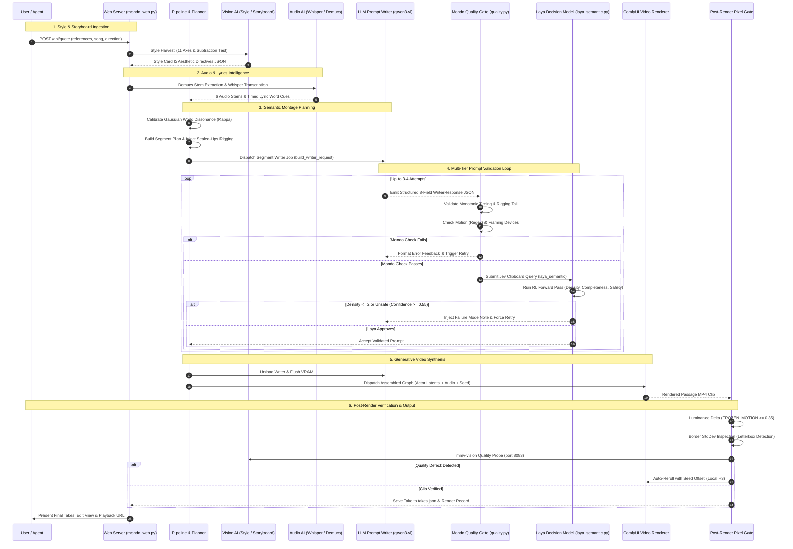

# Behavior Report: Mondo Music Video AI Engine & Complex Interactive Flow
**Scope:** `mmv/worker.py`, `mmv/engine/writer.py`, `mmv/engine/style.py`, `mmv/engine/schema.py`, `mmv/engine/validators/laya_semantic.py`, `mmv/quality.py`, `mmv/vision_check.py`, `mmv/vision_stage.py`, `mmv/lyrics.py`, `mmv/stems.py`, `mmv/voice.py`, `mmv/vocab_select.py`, `mmv/world_vectors.py`, `mmv/storyboard.py`, `mmv/takes.py`  
**Summary:** The Mondo Music Video engine orchestrates a multi-model generative media pipeline combining Vision-Language Models, local large language model prompt writers, a reinforcement-learned decision validator (Laya), audio stem/speech AI (Demucs/Whisper), and diffusion-based video generation (ComfyUI). It enforces deterministic motion and edge-to-edge framing quality gates, multi-tier corrective retry loops, and sealed-lips facial babbling suppressions across modular musical segments. Visual vocabulary selection is dynamically bound via percentile-calibrated Gaussian dissonance, while isolated passage rewrites and rerolls preserve non-destructive take versioning with atomic rollback.

---

## Terms used
- `style_harvest`: Vision AI extraction process that inspects reference images across eleven physical manufacturing axes to output an aesthetic style card and prose directives without pastiche or content nouns.
- `subtraction_test`: Constraint filter ensuring stylistic descriptions omit depictive subject/content nouns and describe only manufacturing, lighting, texture, and edge logic.
- `eleven_axes`: The 11 manufacturing dimensions: Ink Economy, Tonal Structure, Surface, Edge Behaviour, Light Logic, Depth Strategy, Composition Grammar, Scale Relationship, Provenance Markers, Typography, and Motion Implication.
- `thematic_world`: A high-dimensional semantic cluster and vocabulary canon (locations, practices, objects, factions, laws) represented as centroid vectors in latent space.
- `gaussian_dissonance`: Mathematical tension parameter (kappa) calibrated against audio section energy and user slider to inject contrast vocabulary from adjacent or opposite semantic clusters.
- `world_departure`: A transient shot-level vocabulary divergence borrowing terms from a contrast world (mirror, opposite, or tangent) during high-energy musical peaks.
- `sealed_lips`: A prompt engineering constraint appending an explicit negative rigging rule and closing sentence to prevent generative video models from hallucinating mouth babbling under music.
- `rigging_tail`: The exact mandatory closing phrase required at the end of every silent passage prompt: `'Subject Rigging: lips firmly sealed shut, jaw completely relaxed, to prevent any facial babbling or lip-sync hallucinations.'`
- `writer_response`: A strict 8-field JSON payload emitted by the prompt writer containing segment metadata, style opening, retention analysis, shot bodies, soundscape, and music references.
- `mondo_quality_gate`: Deterministic pre-generation and post-render validation enforcing visible motion, non-static camera/subject relationships, edge-to-edge framing, and absence of framing devices.
- `laya_decision_model`: A local reinforcement-learned evaluation agent executing Jev-style clipboard queries to assess prompt visual density, structural completeness, style adherence, and content safety.
- `clipboard_query`: A structured evaluation request submitted to Laya consisting of the uncompressed prompt, state digest, and specific scoring or classification questions.
- `corrective_retry_loop`: An automated iterative feedback cycle that transmits specific Mondo validation failures and Laya failure-mode notes back to the LLM writer for prompt correction (up to 3 or 4 attempts).
- `comfy_latent_conditioning`: The injection of actor reference image latents, downbeat audio conditioning tags, and render seeds into an automated ComfyUI workflow graph.
- `frozen_motion_gate`: Post-render luminance delta threshold (FROZEN_MOTION = 0.35) measuring frame-to-frame pixel change across safe shot interiors to detect still-image render failures.
- `passage_reroll`: Isolated re-rendering of a single musical passage clip using a new renderer seed while preserving musical alignment, prompt, and actor references.
- `passage_rewrite`: Isolated re-synthesis of a single passage prompt that rolls a fresh variation seed and vocabulary rotation while holding shot cuts and song timing constant.
- `atomic_rollback`: A state safety mechanism that backs up plan, prepared, and prompt files and restores them if a rewrite or edit fails validation or encounters an execution crash.
- `storyboard_alignment`: The proportional assignment of narrative and visual storyboard panels across planned shots based on duration and cut timestamps.

---

## Architectural End-to-End AI Flow

---

## Scenarios

### REPORT-01 Visual Style Extraction via 11 Manufacturing Axes
*Evidence:* `mmv/engine/style.py:128-173`, `mmv/worker.py:216-234` | *Confidence:* observed
- **GIVEN** 1 to 9 uploaded PNG reference images in `store.home / 'uploads'`
- **WHEN** the production preparation initiates a style harvest request
- **THEN** a multimodal chat completion payload is compiled embedding the `HARVEST_PROMPT` and base64-encoded image data
- **AND** the prompt mandates evaluation of the 11 physical manufacturing axes while enforcing the Subtraction Test to discard depictive content nouns
- **AND** the vision model returns a JSON object containing `style_card` and `aesthetic_directives` saved to `styles/<style_id>.json`

### REPORT-02 Anti-Pastiche Authorship Stripping
*Evidence:* `mmv/engine/style.py:161-163` | *Confidence:* observed
- **GIVEN** visual reference images reflecting distinct artistic, painterly, or studio aesthetics
- **WHEN** the vision harvester evaluates the images
- **THEN** the system prompt explicitly forbids naming living artists, studios, copyrighted works, or specific photographs
- **AND** the output directives articulate technical manufacturing traits (ink count, edge quality, grain size, falloff) rather than names

### REPORT-03 Whisper Acoustic Lyrics Detection & Timestamping
*Evidence:* `mmv/lyrics.py:100-150`, `mmv/pipeline.py:265-278` | *Confidence:* observed
- **GIVEN** an uploaded musical audio file and an installed Whisper model checkpoint (`tiny` through `large-v3`)
- **WHEN** `detect_lyrics` is invoked with `use_vocals=True`
- **THEN** the worker executes Whisper inference against the separated vocals stem
- **AND** returns an ordered list of transcribed word segments with start seconds, end seconds, and text

### REPORT-04 Authored Lyric Line Alignment
*Evidence:* `mmv/lyrics.py:200-260` | *Confidence:* observed
- **GIVEN** pre-existing detected acoustic timestamps from Whisper transcription
- **WHEN** `align_lyrics` receives raw multiline text
- **THEN** each text row is aligned against the detected token sequences using phonetic matching
- **AND** each row is assigned start seconds, end seconds, and timing confidence (`manual`, `matched`, `interpolated`, or `uncertain`)

### REPORT-05 Demucs Stem Separation and Energy-Driven Pacing
*Evidence:* `mmv/stems.py:40-90`, `mmv/pipeline.py:280-285` | *Confidence:* observed
- **GIVEN** an uploaded audio track and declared meter
- **WHEN** stem separation runs with Demucs (`htdemucs` or `htdemucs_6s`)
- **THEN** audio stems for drums, bass, vocals, guitar, piano, and other are extracted
- **AND** beat energy curves from selected stems drive segment cut placement and choreography parts

### REPORT-06 Performer Vocal Timbre and Cast Presentation Advisory
*Evidence:* `mmv/voice.py:30-70`, `mmv/pipeline.py:367-370` | *Confidence:* observed
- **GIVEN** a cached vocals audio stem and an assigned lead singing actor
- **WHEN** `voice.voice_check` evaluates spectral centroid and formant distributions
- **THEN** an advisory note is attached to the preview quote if detected vocal gender contrasts with actor visual presentation
- **AND** the check remains strictly non-blocking without preventing production start

### REPORT-07 Low-Energy Vocabulary Window Tightening
*Evidence:* `mmv/vocab_select.py:49-86` | *Confidence:* observed
- **GIVEN** an audio passage with section energy below 0.35
- **WHEN** `apply_energy_scaled_vocabulary` evaluates the passage shots
- **THEN** vocabulary selection draws from the top 20% ranked terms of the active vocabulary table
- **AND** preserves held-setting consistency across sequential shots

### REPORT-08 High-Energy Vocabulary Depth and Secondary Stacking
*Evidence:* `mmv/vocab_select.py:53-83` | *Confidence:* observed
- **GIVEN** an audio passage with section energy exceeding 0.80
- **WHEN** `apply_energy_scaled_vocabulary` processes stackable slots (`mechanism`, `lighting`)
- **THEN** the entire table depth is unlocked
- **AND** secondary terms are sampled and appended as comma-separated stacks (`"primary, secondary"`)

### REPORT-09 Percentile-Calibrated Gaussian Dissonance Binding
*Evidence:* `mmv/vocab_select.py:174-262`, `mmv/world_vectors.py:180-220` | *Confidence:* observed
- **GIVEN** an active base Thematic World and a user dissonance slider value (0-100%)
- **WHEN** `plan_gaussian_world_dissonance` computes effective kappa ($\kappa_{eff}$)
- **THEN** visual slots are bound to semantic cluster tiers (`base`, `adjacent`, `tension`, `opposite`, `maximal`)
- **AND** terms are drawn from calibrated cluster distance matrices while preserving Montage Grammar rules

### REPORT-10 High-Energy World Departures
*Evidence:* `mmv/vocab_select.py:148-172` | *Confidence:* observed
- **GIVEN** a production configured with contrast worlds (`mirror`, `opposite`, `tangent`)
- **WHEN** shot energy exceeds the departure threshold (0.65)
- **THEN** non-anchored shot vocabulary terms are borrowed from the selected contrast world pool
- **AND** any pre-established `thematic_anchor` mechanism is preserved

### REPORT-11 Silent Mouths Sealed-Lips System Prompt Composition
*Evidence:* `mmv/engine/style.py:214-249`, `mmv/worker.py:397-401` | *Confidence:* observed
- **GIVEN** a production with `silent_mouths=True` and no singing part in the segment
- **WHEN** `compose_writer_prompt` compiles the system prompt
- **THEN** `{{SILENT_MOUTHS_RULE}}` is replaced with `SILENT_MOUTHS_RULE_V013`
- **AND** `{{RIGGING_EXAMPLE_LINE}}` injects `RIGGING_EXAMPLE_LINE_V013`
- **AND** the prompt mandates lips firmly sealed shut to prevent facial babbling under music

### REPORT-12 Singing Passages Natural Articulation Prompt Composition
*Evidence:* `mmv/engine/style.py:229-240`, `mmv/worker.py:396-401` | *Confidence:* observed
- **GIVEN** a passage planned with active singing lines and an assigned singer
- **WHEN** `compose_writer_prompt` compiles the system prompt for that passage
- **THEN** `{{SILENT_MOUTHS_RULE}}` is replaced with `NATURAL_MOUTHS_RULE`
- **AND** the rigging example line and sealed-lips aesthetic blocks are excised
- **AND** instructions require natural mouth articulation matching lyrics

### REPORT-13 Content Restriction Hard Override Placement
*Evidence:* `mmv/engine/style.py:101-127`, `mmv/engine/style.py:247-249` | *Confidence:* observed
- **GIVEN** active content restrictions (`nudity`, `blood`, `violence`, `sexual`)
- **WHEN** `build_restriction_block` generates the override text
- **THEN** a capitalized `CONTENT RESTRICTIONS — HARD OVERRIDE` block is assembled
- **AND** the block is appended at the very tail of the system prompt to ensure final attention precedence

### REPORT-14 Segment Writer Request Job Packaging
*Evidence:* `mmv/engine/schema.py:99-155`, `mmv/worker.py:413-424` | *Confidence:* observed
- **GIVEN** a planned segment with cut timestamps, camera parameters, and actor tags
- **WHEN** `build_writer_request` constructs the JSON job
- **THEN** it packages `segment_id`, `duration_seconds`, `shot_count`, `shots`, and whitelisted reference tags
- **AND** injects shot-scaled word count targets (`length_requirement`) for writer guidance

### REPORT-15 LLM Prompt Writer Execution
*Evidence:* `mmv/engine/writer.py:4-45`, `mmv/worker.py:495-505` | *Confidence:* observed
- **GIVEN** an assembled system prompt and JSON writer job
- **WHEN** `call_llm` dispatches an HTTP request to the writer endpoint
- **THEN** system and user messages are transmitted with temperature 0.7, max tokens 4096, and timeout 900s
- **AND** writer context usage metrics are tracked via `writer_usage.observe`

### REPORT-16 Writer JSON Response Structural Validation
*Evidence:* `mmv/engine/schema.py:30-80`, `mmv/engine/schema.py:160-165` | *Confidence:* observed
- **GIVEN** raw output from the LLM writer
- **WHEN** `WriterResponse.parse` parses the text
- **THEN** it verifies the existence of all 8 mandatory fields
- **AND** confirms the count of `shot_bodies` strictly equals `len(segment.shots)`

### REPORT-17 Prompt Timestamp Monotonicity and Trim Boundary Gate
*Evidence:* `mmv/engine/schema.py:241-262` | *Confidence:* observed
- **GIVEN** an assembled passage prompt
- **WHEN** `validate_prompt` scans timestamp cuts
- **THEN** it verifies cut timestamps match planned values exactly, are strictly increasing, and fall prior to `segment.musical_frames`
- **AND** flags cut time violations as blocking validation problems

### REPORT-18 Reference Tag Wiring Whitelist Verification
*Evidence:* `mmv/engine/schema.py:263-270` | *Confidence:* observed
- **GIVEN** a prompt generated by the writer
- **WHEN** `validate_prompt` extracts reference tags (`<Image N>`, `<Audio N>`, `<Video N>`)
- **THEN** it validates every tag against actually wired graph references
- **AND** rejects any unwired tag hallucinated by the model

### REPORT-19 Sealed-Lips Rigging Tail Presence Enforcement
*Evidence:* `mmv/engine/schema.py:272-274`, `mmv/worker.py:521-526` | *Confidence:* observed
- **GIVEN** a silent passage prompt missing the rigging tail
- **WHEN** `validate_prompt` scans the text
- **THEN** it flags missing `RIGGING_TAIL`
- **AND** `worker.py` automatically injects `RIGGING_TAIL` preceding `\noverall_soundscape:`

### REPORT-20 Mondo Motion Quality Gate Regex Evaluation
*Evidence:* `mmv/quality.py:75-96` | *Confidence:* observed
- **GIVEN** a prompt declaring a still composition (`composition is static`) or a static camera shot with an unmoving subject and no motion verbs
- **WHEN** `quality.prompt_problems` analyzes the text
- **THEN** it returns a descriptive rejection explaining the motion violation
- **AND** routes the failure to the writer retry feedback loop

### REPORT-21 Mondo Framing Quality Gate Regex Evaluation
*Evidence:* `mmv/quality.py:96-101` | *Confidence:* observed
- **GIVEN** a prompt describing borders, letterboxing, pillarboxing, split-screen, or projected film without director authorization
- **WHEN** `quality.prompt_problems` evaluates the prompt
- **THEN** it rejects the framing device and requires the picture to fill the frame edge-to-edge
- **AND** sends the passage back to the writer

### REPORT-22 Renderer Context Ceiling Length Gate
*Evidence:* `mmv/worker.py:446-447`, `mmv/worker.py:540` | *Confidence:* observed
- **GIVEN** an active renderer reporting `max_prompt_chars` (e.g. Seedance 2 at 10,000 chars)
- **WHEN** an assembled prompt exceeds the limit
- **THEN** `length_problems` flags the context budget overflow
- **AND** prevents submission to paid or remote rendering APIs

### REPORT-23 Laya RL Semantic Decision Model Jev Clipboard Execution
*Evidence:* `mmv/engine/validators/laya_semantic.py:279-385`, `mmv/worker.py:551-558` | *Confidence:* observed
- **GIVEN** a prompt passing deterministic schema and Mondo checks
- **WHEN** `validator.run_clipboard` is invoked
- **THEN** a clipboard request is constructed packaging prompt text, state digest, and 4 questions (`visual_density`, `structural_completeness`, `style_adherence`, `restriction_adherence`)
- **AND** the local Laya RL model (`rl_agent_api.RLAgent`) executes forward inference

### REPORT-24 Laya Low Visual Density Rejection and Failure Mode Diagnosis
*Evidence:* `mmv/engine/validators/laya_semantic.py:410-440` | *Confidence:* observed
- **GIVEN** Laya answers where `visual_density` expected level is 2 or lower and confidence is >= 0.55
- **WHEN** `LayaSemanticValidator.decide` evaluates the response
- **THEN** the prompt is rejected with `"Semantic Validator rejected: Visual density scored X/5."`
- **AND** diagnostic feedback is appended based on `structural_completeness` (`missing_action`, `missing_subject`, `missing_camera_framing`, `missing_lighting_atmosphere`)

### REPORT-25 Corrective Feedback Retry Loop Compilation
*Evidence:* `mmv/worker.py:568-582` | *Confidence:* observed
- **GIVEN** a validation failure from Mondo checks, Laya review, dance rules, or instrument checks
- **WHEN** the retry cycle prepares the next prompt writer attempt
- **THEN** formatted error details are appended under `\n\nCorrect these validation failures in your next response:\n`
- **AND** the writer re-executes with the accumulated feedback up to max attempts (3 or 4)

### REPORT-26 Free Retry Budget on Malformed JSON
*Evidence:* `mmv/worker.py:570-572` | *Confidence:* observed
- **GIVEN** an LLM output that is truncated or unparseable JSON
- **WHEN** `is_broken_json` detects malformed syntax
- **THEN** `free_retries` increments without consuming a full attempt budget
- **AND** the query re-dispatches with unchanged feedback up to `MAX_FREE_RETRIES`

### REPORT-27 GPU VRAM Deallocation Prior to Generative Video Rendering
*Evidence:* `mmv/worker.py:582-598`, `mmv/gpu_memory.py:75-105` | *Confidence:* observed
- **GIVEN** all prompts are validated and written to `prompts.json`
- **WHEN** the pipeline prepares to launch ComfyUI
- **THEN** Laya models are deleted, `gc.collect()` is run, and `torch.cuda.empty_cache()` is called
- **AND** `gpu_memory.wait_released` verifies VRAM returns to baseline before rendering begins

### REPORT-28 ComfyUI Node Graph Latent and Audio Conditioning
*Evidence:* `mmv/engine/comfy.py:40-100`, `mmv/engine/backends/local_h3.py:50-90` | *Confidence:* observed
- **GIVEN** a validated passage prompt, render seed, and actor reference images
- **WHEN** `WorkflowBuilder` constructs the ComfyUI execution graph
- **THEN** actor image latents are assigned to reference loader nodes
- **AND** the audio slice is connected to audio conditioning nodes
- **AND** resolution, frame count, steps, and seed are injected into sampler nodes

### REPORT-29 Deterministic Safe Interior Frame Sampling
*Evidence:* `mmv/vision_check.py:45-78` | *Confidence:* observed
- **GIVEN** a rendered clip with planned cut boundaries
- **WHEN** `sample_frames` calculates an inspection budget of frames
- **THEN** frames within 2 frames of cut boundaries are excluded (`CUT_GUARD = 2`)
- **AND** sample points are placed at safe shot interior midpoints and maximum distance gaps

### REPORT-30 Post-Render Frozen Motion Luminance Differencing
*Evidence:* `mmv/quality.py:120-160`, `mmv/worker.py:740-770` | *Confidence:* observed
- **GIVEN** extracted grayscale frames at 184x104 resolution from a rendered clip
- **WHEN** `frame_differences` calculates mean absolute luminance change between frames
- **THEN** a calculated delta below `FROZEN_MOTION = 0.35` triggers a frozen motion failure
- **AND** causes an automatic local reroll with seed offset on `local_h3`

### REPORT-31 Post-Render Border Standard Deviation Detection
*Evidence:* `mmv/quality.py:165-190`, `mmv/worker.py:740-770` | *Confidence:* observed
- **GIVEN** rendered frames with black letterbox or pillarbox bars
- **WHEN** border analysis evaluates margin standard deviation versus interior standard deviation
- **THEN** margin stddev < 2.0 with interior stddev > 8.0 confirms uniform border artifacts
- **AND** triggers a framing defect flag

### REPORT-32 Secondary Vision Model Semantic Defect Verification
*Evidence:* `mmv/vision_check.py:90-160`, `mmv/vision_stage.py:40-80` | *Confidence:* observed
- **GIVEN** vision quality checking enabled on port 8083 (`mmv-vision`)
- **WHEN** sampled frames are inspected by the vision endpoint
- **THEN** the model returns JSON evaluating `frame_fill`, `framing`, and visual defects
- **AND** watermarks, split screens, and severe anatomical distortions are logged to `quality.json`

### REPORT-33 Automatic Variation Seed Re-sampling on Prompt Rewrite
*Evidence:* `mmv/takes.py:126-214`, `mmv/worker.py:413-416` | *Confidence:* observed
- **GIVEN** an existing completed musical passage
- **WHEN** `rewrite_prompt` is executed for that passage
- **THEN** `_used_segment_vocab` collects existing terms into an exclusion list
- **AND** `replan_segment_vocabulary` rolls a fresh variation seed and picks fresh settings, mechanisms, and lighting
- **AND** the single passage executes prompt generation, Mondo checks, and Laya review
- **AND** updates `plan.json` and `prepared.json` upon passing

### REPORT-34 Atomic State Rollback on Rewrite Failure
*Evidence:* `webapp/mondo_web.py:1923-1934` | *Confidence:* observed
- **GIVEN** an active prompt rewrite or checked edit job
- **WHEN** an exception occurs during writing, validation, or memory release
- **THEN** `prompts.json`, `passage-plan-prompts.json`, `plan.json`, and `prepared.json` are restored from backup bytes
- **AND** previous active prompts and take records remain uncorrupted

### REPORT-35 Storyboard Vision Interpretation and Timeline Alignment
*Evidence:* `mmv/storyboard.py:43-95`, `mmv/worker.py:421-423` | *Confidence:* observed
- **GIVEN** up to 24 uploaded storyboard panel drawings
- **WHEN** storyboard preparation and alignment are executed
- **THEN** the vision service extracts concise prose directions per panel
- **AND** `storyboard.align` proportionally assigns panel directions across planned shots
- **AND** planned musical cut timestamps remain strictly unmodified

### REPORT-36 Resilient JSON Extraction and Reasoning `<think>` Tag Stripping
*Evidence:* `mmv/writer_json.py:21-59` | *Confidence:* observed
- **GIVEN** an LLM writer reply containing `<think>...</think>` reasoning blocks, markdown code fences, or conversational preamble/postamble
- **WHEN** `escape_control_characters` and `extract_json_object` pre-process the raw output before `WriterResponse.parse`
- **THEN** reasoning blocks and surrounding commentary are stripped to isolate the outermost balanced `{...}` JSON object
- **AND** raw control characters inside JSON string literals are escaped without consuming a retry

### REPORT-37 Pre-Compiled Thematic World Centroids and Calibrated Distance Matrix
*Evidence:* `mmv/world_vectors.py:259-264`, `mmv/vocab_select.py:188-207` | *Confidence:* observed
- **GIVEN** the 10 built-in Thematic Worlds in `BUILTIN_THEMATIC_WORLDS`
- **WHEN** `plan_gaussian_world_dissonance` computes Gaussian dissonance weights across segments
- **THEN** it reuses the pre-compiled `BUILTIN_WORLD_CENTROIDS` and `BUILTIN_CALIBRATED_MATRIX` without recomputing embeddings or percentile bounds

### REPORT-38 Laya `style_adherence` Divergence Advisory and Strict Retry Feedback
*Evidence:* `mmv/writer_json.py:66-92`, `mmv/worker.py:556-558` | *Confidence:* observed
- **GIVEN** a Laya semantic review response where `style_adherence.selected == "divergent"` with `confidence >= 0.65`
- **WHEN** `laya_style_feedback` evaluates the response in `mmv/worker.py`
- **THEN** an advisory note is recorded in `segNNN.advice.json`
- **AND** when `strict_prompt_checks` is enabled, a deterministic style adherence corrective problem is appended to trigger a writer retry

### REPORT-39 Creative World and Direction Steering on Passage Prompt Rewrite
*Evidence:* `mmv/takes.py:125-205`, `mmv/worker.py:413-443`, `webapp/mondo_web.py:697-702` | *Confidence:* observed
- **GIVEN** an operator or agent requesting a passage prompt rewrite with optional `world_id` and `direction` steering
- **WHEN** `replan_segment_vocabulary` and the worker prompt stage execute for that passage
- **THEN** the passage's vocabulary pools are overridden by the requested Thematic World or studio World canon
- **AND** the passage-specific direction note steers both contextual vocabulary ranking and the writer job's `conceptual_theme`

---

## Coverage Gaps
| Trigger / Event | Initial State | Scenario ID | Status |
| :--- | :--- | :--- | :--- |
| Style Harvest | 1-9 Valid PNG references | REPORT-01 | Handled |
| Style Harvest | Missing vision model in settings | — | Handled (ValueError) |
| Style Harvest | Path escaping uploads directory | — | Handled (ValueError) |
| Lyrics Detection | Audio mix without vocals stem | REPORT-03 | Handled (falls back to mix) |
| Lyrics Alignment | Ambiguous phonetic match | REPORT-04 | Handled (marked uncertain) |
| Vocals Stem Check | Performer gender conflicts with vocals | REPORT-06 | Handled (advisory note) |
| Vocabulary Selection | Audio passage energy < 0.35 | REPORT-07 | Handled |
| Vocabulary Selection | Audio passage energy > 0.80 | REPORT-08 | Handled (stacks mechanisms) |
| World Dissonance | Dissonance slider 0-100% | REPORT-09 | Handled |
| System Prompt Composition | Silent mouths enabled | REPORT-11 | Handled (sealed-lips rule) |
| System Prompt Composition | Singing mouths enabled | REPORT-12 | Handled (natural mouths rule) |
| System Prompt Composition | Content restrictions active | REPORT-13 | Handled (hard override tail) |
| Writer Response Parse | Missing mandatory JSON fields | REPORT-16 | Handled (ValidationError) |
| Prompt Validation | Timestamp non-monotonic / exceeds trim | REPORT-17 | Handled (Validation problem) |
| Prompt Validation | Unwired reference tag used | REPORT-18 | Handled (Validation problem) |
| Prompt Validation | Missing rigging tail on silent passage | REPORT-19 | Handled (auto-injected) |
| Mondo Quality Gate | Static scene / unmoving subject | REPORT-20 | Handled (Rejected to retry) |
| Mondo Quality Gate | Unauthorized letterbox / framing device | REPORT-21 | Handled (Rejected to retry) |
| Renderer Budget Gate | Prompt exceeds backend max_prompt_chars | REPORT-22 | Handled (Rejected to retry) |
| Laya Review | Visual density <= 2 (Confidence >= 0.55) | REPORT-24 | Handled (Rejected to retry) |
| Laya Review | Restriction safety != safe | — | Handled (Rejected to retry) |
| Corrective Retry Loop | Validation failure on attempt < max | REPORT-25 | Handled (Feedback retry) |
| Corrective Retry Loop | Malformed / truncated non-JSON | REPORT-26 | Handled (Free retry) |
| Generative Rendering | Writer & Laya in VRAM | REPORT-27 | Handled (Unloaded & checked) |
| Post-Render Gate | Luminance delta < 0.35 (Frozen render) | REPORT-30 | Handled (Reroll local H3) |
| Post-Render Gate | Edge stddev < 2.0 (Letterbox bars) | REPORT-31 | Handled (Reroll local H3) |
| Passage Rewrite | User requests new passage prompt | REPORT-33 | Handled (Fresh seed & vocab) |
| Passage Rewrite | Failure during writer/validation | REPORT-34 | Handled (Atomic rollback) |
| Storyboard Ingestion | Uploaded panel drawings | REPORT-35 | Handled (Proportional align) |
| External API Outage | Remote writer connection refused | — | Handled (Unreachable error) |
| GPU Out of Memory | ComfyUI allocation failure | — | Handled (Error report & cancel) |

---

## Unknowns
- Exact internal weights and latent embeddings of the compiled Laya semantic decision model checkpoint (`model.safetensors`), as it is a proprietary trained RL policy.
- Upstream cloud queue scheduling latency and GPU cluster allocation specifics for Seedance and WaveSpeed backends when running remote renders.
- Exact phonetic alignment failure rates on heavily distorted or extreme death-metal/hyperpop vocal styles without isolated acapella stems.

